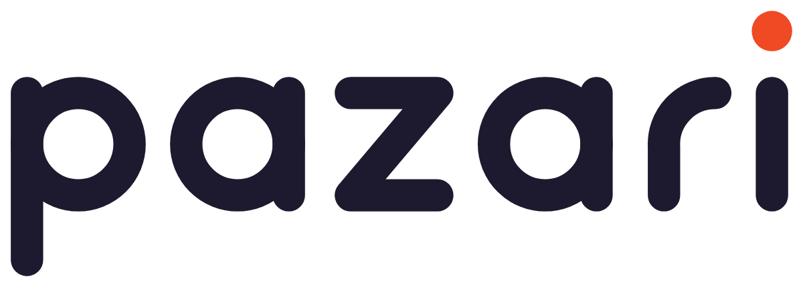

# Pazari brand

## Name

**pazari** (always lowercase in the logo; "Pazari" in running text). From the Greek *παζάρι*: a bazaar, and the act of haggling for a better price. It is short, easy to say in Greek and English, and it says what the service does: it bargains across every shop for you.

**Tagline:** Όλα τα καταστήματα. Μία αναζήτηση. / *Every shop. One search.*
**Home headline:** Βρες την καλύτερη τιμή / *Find the best price*

## Logo

* **Wordmark.** Custom geometric lettering: round bowls, round stroke ends and one stroke weight throughout. It is drawn from code (`scripts/brand-geometry.mjs`) rather than typed in a font. The dot of the **i** is always paprika: it is the "found it" spark.
* **App icon.** A market-stall awning over the "p". Use it at 48 px and above.
* **Small icon** (favicons, 16 to 32 px). The "p" on a paprika tile, with no awning.
* **Clear space:** at least the height of the i-dot around the logo. **Minimum width:** 80 px on screen.
* Don't recolour the letters in brand colours, stretch, outline, or put the wordmark on busy photos. On dark backgrounds use `logo-reverse.svg`.

| File | Use |
| --- | --- |
| `brand/logo.svg` | Default: ink wordmark, paprika dot |
| `brand/logo-reverse.svg` | On dark backgrounds |
| `brand/logo-mono-black.svg`, `logo-mono-white.svg` | One-colour print, stamps, embroidery |
| `brand/icon.svg`, `icon-square.svg` | App icon (rounded / full-bleed) |
| `brand/icon-small.svg` | Favicon art |
| `brand/lockup.svg`, `lockup-reverse.svg` | Icon + wordmark side by side |
| `brand/png/*` | PNG exports (logo 1200 px, icon 1024 px, lockup) |
| `public/og.png` | Social share image (1200 × 630) |

## Colour

| Name | Hex | Use |
| --- | --- | --- |
| Paprika | `#EF4A23` | Logo dot, awning, discount badges, highlights |
| Paprika deep | `#C9361A` | Buttons and links (5.2:1 on white, passes WCAG AA) |
| Ink | `#1D1A2F` | Text, wordmark, icon background |
| Cream | `#FFF6EC` | Warm backgrounds (home page) |
| Saffron | `#FFB627` | Icon dot, accents |
| Mint | `#17A673` (text: `#0B7A52`) | Free delivery, best price |
| Plum | `#6D4AE8` | Illustration accent |
| Sky | `#2E9BE6` | Illustration accent |

The palette is taken from a spice market: paprika, saffron, mint. Ink and cream keep it calm. Use paprika for small accents only; large paprika areas belong to the awning.

## Type

**Commissioner** (variable, free, Google Fonts / Fontsource), which covers Latin and Greek. Headings are 700 to 750 weight with tight tracking (-0.02em). Body text is 450 to 500, and UI labels 600 to 650. Small uppercase labels use +0.07em tracking.

## Motifs

* **The awning:** scalloped paprika and white stripes along the top of the home page, the social image and the app icon.
* **Carts that fill up:** coloured shapes (balls, boxes, pills) in the accent colours drop into carts as you type. The same shapes can be used in ads and social posts.
* **Rounded everything:** 12 to 20 px corner radius, round stroke ends, pill tags. This matches the wordmark.
